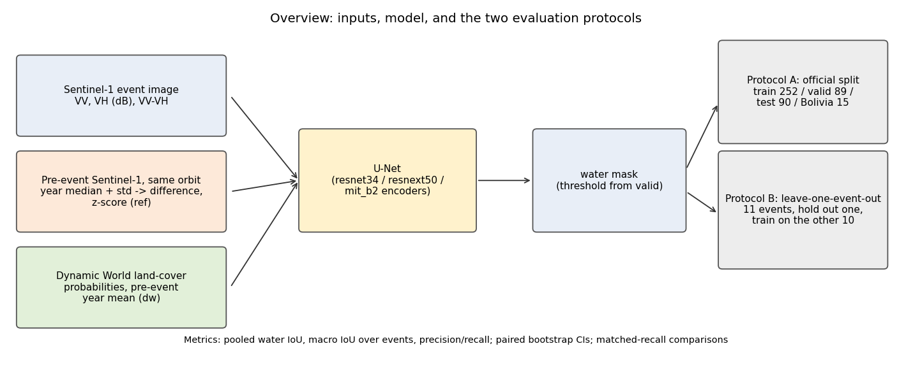
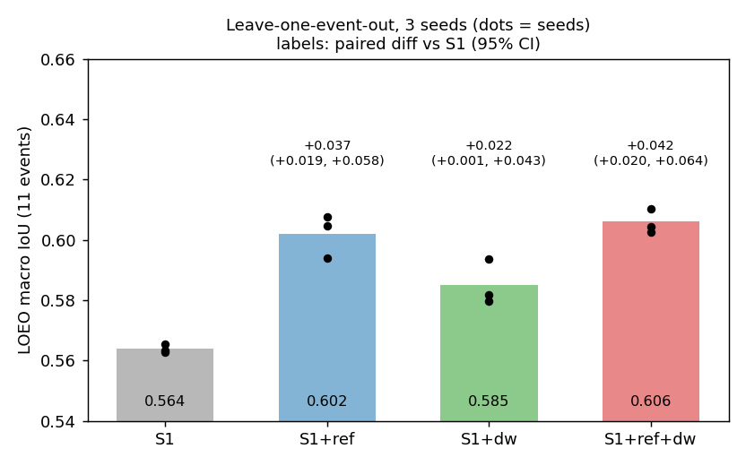

# Project guide: problem statement and end-to-end Q&A

Author: Bharath Pranav S | Repository: https://github.com/Hirata-Origami/FloodSegmentation

A plain-language walkthrough of the project, followed by the questions a reviewer, jury or hackathon panel is likely to ask, with honest answers. All numbers come from the logs and tables in this repository (`README.md`, `results/`).

---

## 1. The problem in one page

**Task.** Given a radar image (Sentinel-1) taken during a flood, mark which pixels are open water. Radar sees through clouds and at night, so it is the main data source in the first hours of a flood, when optical satellites are blind.

**Where it goes wrong.** Water is dark in radar, but so are other things: wet soil, bare sand, radar shadow behind hills, tarmac. A model trained on a handful of floods learns to call some of these "water". These **false positives** are the dangerous failure for emergency use ("it says flooded, but it is not"), and they are worst on floods the model has never seen.

**What the field usually does.** Report one number (IoU) on a fixed test split of a benchmark (Sen1Floods11). In that split, test images come from the *same floods* as the training images. That says little about the real use case: a **new** flood in a **new** place.

**What we did.**
1. Measured performance on **unseen floods** with leave-one-event-out (LOEO): hold out all images of one flood, train on the other ten, repeat for all 11 floods.
2. Tested, one at a time and with confidence intervals, many ideas for reducing false positives (extra inputs, losses, post-processing).
3. Found what helps: giving the model **what the place normally looks like** (a pre-event Sentinel-1 reference from the same orbit) and **what the ground is** (Dynamic World land-cover probabilities).
4. Reported clearly what did **not** help and what is **not** statistically established.

**Headline numbers.**
- Single-date radar baseline: 0.69 IoU on the official test split, but 0.56 on unseen floods (macro over 11 events).
- With pre-event reference + land cover: +0.042 macro IoU on unseen floods (95% CI 0.020 to 0.064; positive for all 3 seeds), precision 0.71 to 0.81, and Somalia/Pakistan precision from 0.31/0.38 to 0.81/0.74.
- On the official split the gain is about +0.02 IoU and **not statistically significant** (the test set is only 90 images).

---

## 2. Glossary

- **Sentinel-1 (S1):** European radar satellites; VV and VH are two polarisations; values in decibels (dB).
- **Sen1Floods11:** public dataset of 446 hand-labelled 512x512 pixel (10 m) image chips from 11 floods, with an official train/valid/test split (252 / 89 / 90 chips) plus a separate Bolivia set (15 chips).
- **IoU (intersection over union):** overlap between predicted and true water divided by their union; here pooled over all pixels of a set (water class only; unlabeled pixels ignored).
- **Macro IoU:** mean of the per-event IoU over the 11 events (every flood counts equally).
- **Precision / recall:** fraction of predicted water that is real / fraction of real water that is found. False positives lower precision.
- **LOEO:** leave-one-event-out evaluation (see above).
- **ref (pre-event reference):** per-pixel median and standard deviation of Sentinel-1 images from the year before the flood (same orbit), turned into difference and z-score channels.
- **dw (land cover):** Dynamic World land-cover class probabilities (trees, crops, built, bare, water, ...), averaged over the year before the flood.
- **Paired bootstrap CI:** confidence interval for a difference between two models computed on the same images (resampled with replacement), so shared difficulty cancels out.
- **Matched-recall precision:** precision compared at the same recall, to separate a better model from a mere change of threshold.

---

## 3. What we built and how it works

1. **Inputs per image chip:** VV, VH, VV-VH (always); optionally `ref` (4 channels), `dw` (9 channels).
2. **Model:** U-Net with an ImageNet-pretrained encoder (resnet34 for LOEO; resnet34, resnext50_32x4d and mit_b2 for the official-split ensembles).
3. **Training:** BCE + Dice loss, 256 px random crops, flips/rotations and a small backscatter shift, exponential moving average of weights, mixed precision. LOEO: 1500 steps, no checkpoint selection. Official split: 3000 steps, best epoch chosen on the validation set.
4. **Inference:** four-way flip averaging; ensemble of 15 models (3 encoders x 5 seeds); decision threshold chosen on the validation set only.
5. **Evaluation:** official split (standard) and LOEO (new), with paired bootstrap intervals; plus matched-recall comparisons and exclusion-mask tests.
6. **Engineering:** a two-GPU job queue (one worker per T4), per-job result files so interrupted runs resume, Earth Engine fetches cached to disk. Everything ran on free Kaggle GPUs.

---

## 4. Results at a glance

| LOEO, 3 seeds (resnet34) | macro IoU | paired diff vs S1 (95% CI) | seed-ens. precision | Somalia / Pakistan precision |
|---|---|---|---|---|
| S1 (baseline) | 0.564 | - | 0.706 | 0.31 / 0.38 |
| + pre-event reference | 0.602 | +0.037 (+0.019, +0.058) | 0.768 | 0.70 / 0.59 |
| + land cover | 0.585 | +0.022 (+0.001, +0.043) | 0.790 | 0.82 / 0.72 |
| + both | 0.606 | +0.042 (+0.020, +0.064) | 0.805 | 0.81 / 0.74 |

| Official split, 15-model ensembles | test IoU (95% CI) | paired diff vs S1 (95% CI) | Bolivia IoU |
|---|---|---|---|
| S1 | 0.690 (0.578-0.774) | - | 0.606 |
| + reference | 0.710 (0.612-0.787) | +0.020 (-0.001, +0.053) | 0.691 |
| + land cover | 0.710 (0.608-0.785) | +0.020 (-0.014, +0.063) | 0.601 |
| + both | 0.706 (0.600-0.786) | +0.016 (-0.036, +0.072) | 0.715 |

What did **not** help (LOEO paired difference vs S1): terrain inputs (+0.006 / +0.011, intervals include 0), relative-backscatter channels (-0.015), event weather scalars (-0.062), Tversky loss (-0.030), Lovasz loss (+0.012, interval includes 0), weak-label pretraining, stronger augmentation, bigger crops, small-component removal, a chip-level water gate, and terrain / land-cover exclusion masks. See `figures/fig4_everything_tried.png`.

---

## 5. Questions and answers

### A. Problem and motivation

**Q1. What problem are you solving, in one sentence?**
Reducing false alarms when mapping floods from radar satellite images, and measuring honestly how well that works on floods the model has never seen.

**Q2. Why radar (Sentinel-1) and not optical images?**
Radar works through clouds and at night, and floods come with clouds. Optical imagery gives much higher accuracy on this dataset when it is available (published optical-model scores are far higher), but it is often unusable exactly when it is needed.

**Q3. Why do false positives matter more than a few missed pixels?**
A false flood alert can send rescue resources to the wrong place and erodes trust in the product. Misses matter too; that is why we report precision *and* recall, and why the main metric is IoU, which penalises both.

**Q4. Who would use this?**
Flood-mapping services and researchers who want to know how a radar model will behave on the *next* flood. Our evaluation protocol is useful to them even if they keep their own model.

**Q5. What gap in existing work does this fill?**
Most results use a single official split where test chips come from floods that also appear in training. We add event-level (LOEO) evaluation with confidence intervals, a controlled comparison of many ideas, and a recall-matched check that separates real improvement from threshold shifts.

### B. Data and task

**Q6. What data did you use?**
Sen1Floods11 hand-labelled chips: 446 images (512x512 px, 10 m) from 11 floods, label 1 = water, 0 = land, -1 = unlabeled (ignored). Splits: train 252, valid 89, test 90, plus Bolivia 15 (a held-out event). About 10.6% of labelled pixels are water.

**Q7. Where do the extra inputs come from?**
Google Earth Engine: Sentinel-1 archive (`COPERNICUS/S1_GRD`) for the pre-event reference, Dynamic World (`GOOGLE/DYNAMICWORLD/V1`) for land cover. Terrain (JRC, NASADEM, slope, HAND) and ERA5-Land weather were tested too.

**Q8. How is the pre-event reference built?**
For each chip, using the metadata of its flood event (date, orbit pass, relative orbit), we take same-orbit images from the year before the flood (ending 12 days before the event image so early flooding stays out) and compute the per-pixel median and temporal standard deviation. The model receives the difference between the flood image and the median, and a z-score using the standard deviation (with a 1 dB floor).

**Q9. Could the reference or land cover leak the answer?**
We checked the design for this: the reference ends 12 days before the event image and uses a one-year median, so a short earlier inundation has little weight; Dynamic World is computed from earlier optical images and is averaged over the pre-event year, so it does not contain the flood. The labels were made from imagery at event time. Both inputs are products of other models/sensors with their own errors, which we do not model. We did not test a case with an earlier flood inside the reference window.

**Q10. What if a place has no pre-event images?**
Every event in the dataset had images in the reference window (about 12 in the one-year window for India 2016, up to 78 for Spain). If an image is missing, the input is set to a neutral value, but we did not study that regime.

### C. Method

**Q11. Why a U-Net and not a transformer or foundation model?**
We compared three encoders (two CNNs and a transformer, mit_b2) for the official-split ensembles; the conclusions held across them, and architecture was not the bottleneck (all model families converged near 0.69 IoU for single-date radar). We did not test large remote-sensing foundation models or SAR-pretrained backbones.

**Q12. Why combine so many models?**
Ensembling stabilises predictions and reduces seed noise; each variant uses 15 models (3 encoders x 5 seeds) so that a comparison is between ensembles, not between lucky runs. Ensembling alone gave very little gain over the best single model.

**Q13. How is the decision threshold chosen?**
On the validation set only (the threshold that maximises validation IoU in a 0.30-0.70 grid); LOEO uses a fixed 0.5. Nothing is tuned on the test set.

**Q14. Why did you try so many ideas?**
To find out what actually reduces false positives instead of assuming. Each idea was a controlled change against the same baseline with the same events, so the negative results are informative too (Figure 4).

**Q15. Why not train on all the data, including validation chips?**
The standard protocol trains on the train split and selects on valid. As an extra, we also trained on train+valid (341 chips, fixed schedule, threshold taken from the train-only ensemble). It adds about 0.01-0.02 IoU, but it is a different protocol, so we report it separately.

### D. Evaluation and statistics

**Q16. Why leave-one-event-out?**
Because in practice the next flood is a new event. In the official split the test images come from floods that are also in training, which flatters the model (0.69 vs 0.56-0.57 on unseen events for the baseline).

**Q17. How do you know the improvement is not noise?**
LOEO: 3 independent training seeds, all three per-seed differences positive (+0.037/+0.042/+0.047 for the combined variant), and a paired bootstrap interval that excludes 0. A separate, more conservative event-level sign test (comparing per-event IoU with the baseline) gives: reference better on 10 of 11 events (p = 0.012), reference+land cover better on 9 of 10 non-tied events (p = 0.022), land cover alone better on only 7 of 11 (p = 0.55). So the reference effect is solid; the land-cover-alone effect rests on a few events.

**Q18. Your bootstrap resamples images, not events. Is that a problem?**
Yes, it is a limitation: it measures uncertainty from which images were drawn within each event, not from which events happened to be in the dataset. That is why we added the event-level sign test, and why we call the LOEO result "consistent across events" rather than a population-level guarantee. With only 11 events, a larger event set would be needed to estimate how much the benefit varies across floods in general.

**Q19. Did you correct for testing many variants?**
No formal correction. The screen of many ideas used single seeds; the three variants we report as positive were then confirmed with three new seeds. The negative results survive any correction (they are not significant to begin with); the positive ones should be read with the event-level test above, which is less sensitive to multiple chip-level comparisons.

**Q20. Why is the official-split improvement not significant?**
The test set has 90 chips and a 95% interval about +-0.1 wide in IoU. We see about +0.02, which that test cannot resolve. The point estimates agree across two independent runs (9-model and 15-model ensembles).

**Q21. What is matched-recall precision?**
A model can look "more precise" just because its threshold is stricter. We compare precision at the same recall. At macro recall 0.744: S1 0.706, reference 0.768, land cover 0.750, both 0.791. The Tversky loss, which first looked like a precision gain, was *less* precise than the baseline at matched recall.

**Q22. Why pooled IoU per set and not an average over images?**
Pooled IoU is what the dataset's evaluation uses and is dominated by large flooded areas; for LOEO we also report macro IoU over events so small events count equally.

### E. Interpreting the results

**Q23. Do you beat the state of the art?**
No, and we do not claim to. The published figure often quoted (0.72 test IoU, DeepSARFlood) uses different inputs (six channels including terrain and JRC), a custom weak-label training set we do not have, and possibly different label/metric details; the repository we inspected contains only inference code. Our 15-model ensembles score 0.706-0.710 with intervals that contain 0.72, so we can neither claim to beat nor to miss it.

**Q24. So what is the contribution?**
(1) An event-level evaluation showing a large gap between within-event and new-event performance; (2) a controlled map of what does and does not reduce false positives; (3) evidence, with intervals, that a pre-event reference and land-cover probabilities reduce false positives on unseen floods; (4) all code and logs. The pre-event reference idea is not new (prior bi-temporal work exists); our contribution is testing it under event-level evaluation next to many alternatives.

**Q25. Which input matters more: reference or land cover?**
The reference gives most of the IoU gain (+0.037 vs +0.022) and is the more consistent across events. Land cover mostly adds precision (0.79 macro precision alone, 0.81 with the reference) but is event-dependent and less stable (for example it is unstable on Bolivia for the mit_b2 encoder).

**Q26. Why did terrain not help, when operational services use it?**
Operational services use terrain mainly as exclusion masks. We tested terrain as inputs and as post-filters (HAND above 15 m, slope above 5 degrees): no reliable gain, and the slope filter cut recall. Our channel-stacking test does not rule out other ways of using terrain (for example a separate fusion branch, which other work reports as helpful).

**Q27. Why did weather inputs hurt?**
Our hypothesis (not tested directly): weather reanalysis is coarse (about 11 km) so each event has essentially one value, and a network can memorise events from it, which LOEO punishes. The result (-0.062 macro IoU) is clear; the explanation is a hypothesis.

**Q28. Where does the model still fail?**
Somalia and Pakistan remain the hardest events (IoU about 0.33-0.49 even with the best variant), and Paraguay gets slightly worse with the reference. We did not run a per-chip analysis of *why* each false positive occurs; the usual suspects (wet soil, sand, shadow) come from the literature, not from our own labels.

### F. Limitations (answer these first if asked)

**Q29. What are the biggest limitations?**
- LOEO comparisons use one encoder (resnet34); the other ideas were screened with a single seed.
- Only 11 events; event-level uncertainty is large (Q18).
- The official test split is small; no official-split difference is significant.
- The helpful inputs need a pre-event archive of same-orbit images and a land-cover product, so the task becomes multi-source and bi-temporal; results are not comparable to single-date scores.
- The dataset contains no urban floods (per the dataset paper), so we say nothing about cities.
- Labels were produced by other means (optical, hand-drawn) and contain their own noise.
- Hyperparameters were not tuned per variant.
- Not peer reviewed.

**Q30. Would this work in a new region or with a different sensor?**
Unknown. We only tested 11 floods of one sensor; LOEO is the closest proxy for a new region, and the benefit varied by event (positive on 10/11 for the reference, negative on Paraguay).

### G. Deployment and real-world use

**Q31. How would you deploy it?**
For each new flood image: fetch the same-orbit images of the previous year and the land-cover mean (both from an archive), compute the channels, run the ensemble (about 15 forward passes per chip with flip averaging), apply the validation-chosen threshold. The heavy part is the archive query, not the network.

**Q32. Is it real-time?**
Inference on a chip takes well under a second on a GPU; the archive queries and tiling dominate, and we did not benchmark a production pipeline.

**Q33. Should it be used for emergency decisions today?**
Not on its own. It is a research prototype validated on 11 events; it should be used with human review and further validation on the target region.

**Q34. What are the main risks?**
False negatives (missed flooded areas) and false positives (false alarms), unmeasured behaviour in cities and under dense vegetation, and silent failure when the pre-event archive is thin or contaminated by earlier floods.

### H. Reproducibility and compute

**Q35. Can someone reproduce this?**
Yes: notebooks 01-07 contain all code, with a `SMOKE=True` dry-run switch; logs of the runs and all result tables are in `results/`; a Kaggle account with Earth Engine access is required. Training jobs write their results individually, so a stopped run resumes.

**Q36. How much compute did it take?**
Free Kaggle GPUs (2 x T4). The full final run took 10.9 h from scratch (3-seed LOEO of 132 jobs about 5 min each, 60 official-split models about 10-17 min each, 12 train+valid models); completing the remaining jobs with reused results took 4.4 h.

**Q37. Are results deterministic?**
No: GPU training is not bit-exact, and seed 0 of a re-run gave slightly different numbers (for example S1 seed 0 LOEO macro IoU was 0.568 in one run and 0.566 in another). That is why we use several seeds and intervals.

### I. Ethics and responsibility

**Q38. What are the ethical considerations?**
Flood maps affect where aid goes. We report limitations explicitly, avoid claiming operational readiness, and release code so others can check the work. The data are public satellite imagery; no personal data are used.

### J. Future work

**Q39. What would you do next with more time or compute?**
More flood events for training and evaluation, LOEO with more encoders and seeds, several pre-event images instead of a median, SAR-pretrained backbones, and a per-chip failure analysis to confirm what causes the remaining false positives.

**Q40. What would change your conclusions?**
If a larger event set showed the benefit of the reference disappearing in many regions, or if the official-split gain stayed at +0.02 with a much larger test set, we would state the effect as small. If the benefit held on more events and encoders, we would call it robust.

### K. Tricky questions

**Q41. "The official-split gain is not significant. Why should I care?"**
Because that split cannot answer the question that matters (new floods): its test images come from floods seen in training and it has 90 images. On unseen floods the gain is consistent across seeds and on 9-10 of the events, and it targets the failure mode (false positives on hard events) that the official split hides.

**Q42. "Isn't a pre-event reference an old idea?"**
Yes, and we say so. We did not invent it; we measured it under event-level evaluation with controlled alternatives and intervals, and found which parts matter (reference vs land cover) and which popular additions do not (terrain, weather, losses).

**Q43. "Is this p-hacking, given how many things you tried?"**
We tried many things and report all of them, including failures (Figure 4). The promising variants were then re-run with new seeds, and we added an event-level test that does not depend on chip counts. We still call the land-cover-alone result tentative.

**Q44. "Why only 0.69 on the official split when optical models score 0.8+?"**
Different sensor and information: radar confuses dark land with water, and the labels come from optical imagery. This is the gap that the extra context inputs try to narrow; they close part of it on unseen floods but not the official-split gap in a significant way.

**Q45. "What is the single most important figure?"**
Figure 4 (`figures/fig4_everything_tried.png`): every idea against the baseline with its confidence interval. Only the reference, land cover and their combination clear zero.

---

## 6. Pitches

**30 seconds.** Radar flood maps cry wolf on floods they have not seen, and the usual benchmark hides it. We evaluate on unseen floods, test what really cuts false alarms, and find that telling the model what the place normally looks like (a pre-event radar reference) and what the ground is (land cover) lifts IoU by 0.04 and precision from 0.71 to 0.81 on unseen floods. We also show what does not work, with confidence intervals, and we do not claim a new state of the art.

**2 minutes.** Add: the problem (false positives on Somalia/Pakistan, precision 0.31/0.38); the protocol (11-event leave-one-event-out, 3 seeds, paired bootstrap, matched recall); the results table in section 4; the negative results (terrain, weather, losses, post-filters); and the limitations (one encoder in LOEO, 11 events, official-split gain not significant, bi-temporal not comparable to single-date scores).

---

## 7. Where to find things

- Overview, tables and figures: `README.md`
- One-page abstract: `docs/abstract_1page.pdf` (text in `docs/abstract.md`)
- Result tables: `results/*.csv`; full printouts: `results/run06_analysis_output.txt`, `results/run07_analysis_output.txt`
- Notebooks: `notebooks/01...07`; scripts: `scripts/`
