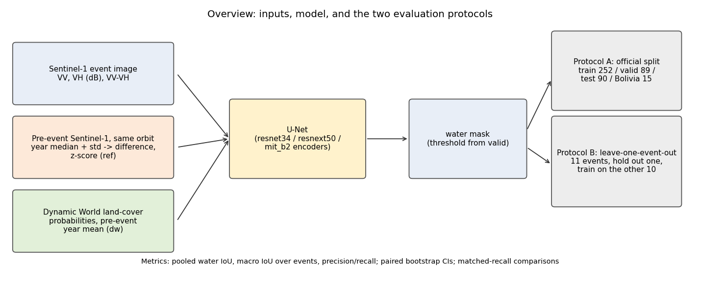
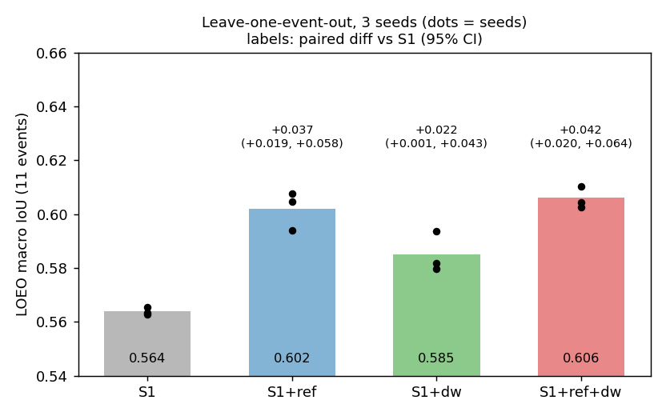
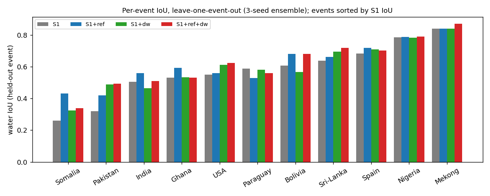
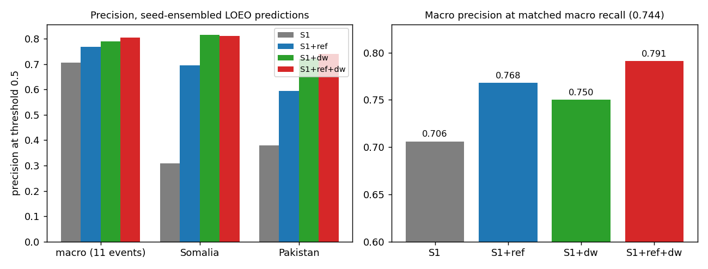
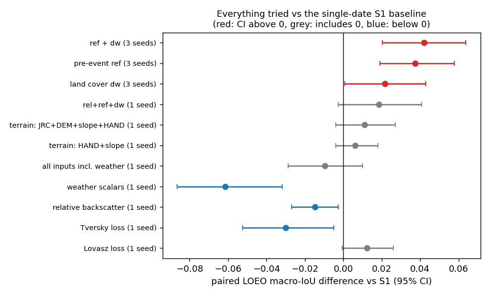
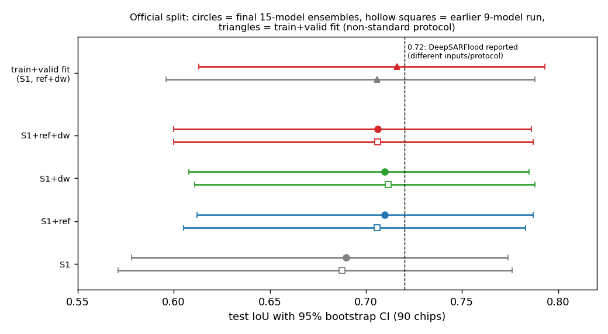
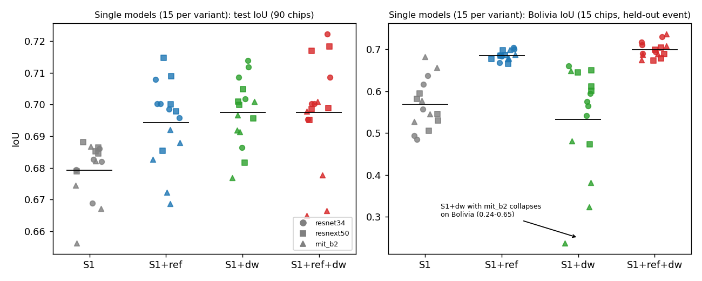

# Sentinel-1 flood segmentation on Sen1Floods11: leave-one-event-out evaluation, pre-event reference and land-cover context

Author: Bharath Pranav S | Repository: https://github.com/Hirata-Origami/FloodSegmentation

Code, logs and results of a study of **false positives in single-date Sentinel-1 flood mapping**. Everything ran on Kaggle (2 x T4). This page explains what we did, everything we tried, and what happened, with tables and figures.

See [`GUIDE.md`](GUIDE.md) for the problem statement and an end-to-end question-and-answer guide, and [`docs/abstract_1page.pdf`](docs/abstract_1page.pdf) for a one-page abstract.

## Abstract

> Deep-learning flood mapping from Sentinel-1 radar is usually reported on the official Sen1Floods11 test split, where chips from the same flood events appear in training. We re-evaluate single-date Sentinel-1 U-Net models with leave-one-event-out (LOEO) testing over the 11 hand-labelled events, using three training seeds, paired bootstrap intervals, matched-recall precision comparisons and per-event precision. Single-date Sentinel-1 ensembles reach 0.69 water IoU on the official test split, but only 0.56-0.57 macro IoU on unseen events; the hardest events (Somalia, Pakistan) are dominated by false positives, with precision of about 0.31 and 0.38. Terrain inputs (JRC, elevation, slope, HAND), weak-label pretraining, Tversky and Lovasz losses, augmentation, larger context, connected-component cleanup, land-cover or terrain exclusion masks, and event-level weather scalars gave no reliable gain, and the weather scalars, which take roughly one value per event, reduced LOEO IoU by 0.06. Supplying a same-orbit pre-event reference (one-year median, as a difference and z-score) raised LOEO macro IoU by 0.037 (95% CI 0.019 to 0.058; positive for all three seeds), Dynamic World land-cover probabilities raised it by 0.022 (0.001 to 0.043), and both together by 0.042 (0.020 to 0.064; 0.564 to 0.606). The pre-event reference accounts for most of the IoU gain, whereas land cover mainly adds precision: macro precision of seed-ensembled predictions rose from 0.71 to 0.77 (reference), 0.79 (land cover) and 0.81 (both), with Somalia precision rising from 0.31 to 0.70-0.82 and Pakistan from 0.38 to 0.59-0.74; the precision gains persist at matched recall. On the official split, 15-model ensembles improved from 0.690 to 0.706-0.710 test IoU, but the paired differences are not statistically significant on its 90 test chips. These inputs make the task multi-source and bi-temporal, so the results are not directly comparable to single-date published scores. We release all code and logs.

## TL;DR

- Single-date Sentinel-1 U-Nets reach ~0.69 water IoU on the official Sen1Floods11 test split, but only **0.56-0.57 macro IoU on unseen events** (leave-one-event-out, LOEO). Somalia and Pakistan fail mostly through **false positives** (precision about 0.3-0.4).
- **What helped** (3 seeds, paired intervals above 0): a same-orbit **pre-event reference** (+0.037 macro IoU), **Dynamic World land-cover probabilities** (+0.022), and both together (+0.042, 0.564 to 0.606). The reference gives most of the IoU gain; land cover mainly adds precision (0.71 to 0.77 / 0.79 / 0.81).
- **What did not help:** terrain inputs (JRC, DEM, slope, HAND), weak-label pretraining, Tversky and Lovasz losses, stronger augmentation, bigger context, small-component removal, a chip-level water gate, terrain/land-cover exclusion masks, relative-backscatter channels, and event-level weather scalars (which hurt: -0.06).
- On the **official split** (15-model ensembles per variant) all improvements are small (+0.016 to +0.020 test IoU, 0.690 to 0.706-0.710) and **not statistically significant** (90 test chips). We do not claim to beat any published number: the helpful inputs make the task multi-source / bi-temporal.

## Figures


_Figure 0. Overview: inputs (event image, pre-event reference, land cover), the U-Net, and the two evaluation protocols._


_Figure 1. LOEO macro IoU over the 11 events for 3 training seeds (dots) and their mean; labels show the paired difference vs S1._


_Figure 2. Per-event IoU of the seed-ensembled LOEO predictions. The largest gains are on the hardest events (Somalia, Pakistan); Paraguay gets worse with the reference._


_Figure 3. Left: precision on the hard events. Right: macro precision at matched macro recall, showing the gain is not just a shifted threshold._


_Figure 4. Every idea tested, as the paired LOEO macro-IoU difference vs the S1 baseline with 95% CI. Only the pre-event reference, land cover and their combination clear zero._


_Figure 5. Official-split test IoU with 95% bootstrap CI (circles: final 15-model ensembles; hollow squares: earlier 9-model run; triangles: train+valid fit). Everything overlaps, including the 0.72 line (a published number with different inputs and protocol)._


_Figure 6. All 15 single models per variant (3 encoders x 5 seeds). Left: test IoU. Right: Bolivia, a held-out event, where models using the pre-event reference are stable (about 0.67-0.74) while S1-only models scatter (0.49-0.68) and `S1+dw` with mit_b2 collapses (0.24-0.65)._

## What we did

**Data and task.** Sen1Floods11 hand-labelled chips (446 chips, 512x512 px, 10 m, Sentinel-1 VV/VH in dB, label 1 = water, 0 = land, -1 = ignored) from 11 flood events, with the official train / valid / test / Bolivia split (252 / 89 / 90 / 15 chips). Metric: pooled IoU of the water class per set; for LOEO, the IoU of each held-out event and the macro mean over events.

**Why leave-one-event-out.** In the official split, test chips come from events that also appear in training. In LOEO, all chips of one event are held out and the model trains on the other 10, which measures generalisation to a new flood. Confidence intervals come from a paired bootstrap over chips (resampled within events), and for 3-seed results the difference is averaged over seeds.

**Models and training.** U-Net from `segmentation-models-pytorch` with ImageNet-pretrained encoders (resnet34 for LOEO; resnet34, resnext50_32x4d and mit_b2 for the official-split ensembles), BCE + Dice loss, AdamW, one-cycle schedule, exponential moving average of weights, 256 px random crops with flips/rotations and a +-1 dB backscatter shift, mixed precision. LOEO: 1500 steps, no checkpoint selection. Official split: 3000 steps, best epoch chosen on valid, 4-way flip test-time augmentation, ensemble threshold chosen on valid only.

**Extra inputs (all per-chip, from Google Earth Engine).**

- `ref`: pre-event reference from `COPERNICUS/S1_GRD`, same orbit pass and relative orbit as the event image, per-pixel median and temporal standard deviation over the year before the event (ending 12 days before it), given as VV/VH difference and z-score channels.
- `dw`: Dynamic World land-cover class probabilities (9 channels), mean over the pre-event year.
- `wx`: ERA5-Land antecedent precipitation (1/7/30/90 days) and soil moisture as constant channels.
- Terrain: JRC water seasonality, NASADEM elevation, slope, HAND.

## Experiments: what we tried and what happened

| #   | Notebook   | Question                                                                             | Result                                                                                                                                       | Verdict                                    |
| --- | ---------- | ------------------------------------------------------------------------------------ | -------------------------------------------------------------------------------------------------------------------------------------------- | ------------------------------------------ |
| 1   | `01`       | How good is a 9-model encoder ensemble with weak-label pretraining (official split)? | Test IoU 0.671 (0.557-0.756); weak-label pretraining did not help (single seed: 0.654 with vs 0.693 without)                                 | Weak labels not useful here                |
| 2   | `02`       | Do terrain inputs close the gap?                                                     | LOEO macro IoU 0.564 (S1) vs 0.570 (HAND+slope) vs 0.573 (all terrain), CIs include 0; official split 0.687 vs 0.686; Bolivia 0.597 vs 0.432 | No                                         |
| 3   | `03`       | Do CV tricks (augmentation, loss, context, cleanup, gate) cut false positives?       | Macro IoU 0.575 base; 0.567 / 0.573 / 0.566 / 0.574 for the variants; cleanup changed IoU by <0.001; gate 81% accurate, no gain              | No                                         |
| 4   | `04`, `05` | Does it hold with 3 seeds? Balanced 15-model ensembles? More data?                   | LOEO +0.037 / +0.022 / +0.042 (all seeds positive); official split 0.690 to 0.706-0.710 (not significant); train+valid fit adds ~0.01-0.02   | Confirmed on LOEO, small on official split |

## Detailed results

### 1. Leave-one-event-out, 3 seeds (main result)

U-Net resnet34, 1500 steps, threshold 0.5.

| Variant            | macro IoU, mean +- sd (3 seeds) | seed-ensemble macro IoU | seed-ensemble macro precision | Somalia prec. | Pakistan prec. | paired diff vs S1 (95% CI) | per-seed diffs         |
| ------------------ | ------------------------------- | ----------------------- | ----------------------------- | ------------- | -------------- | -------------------------- | ---------------------- |
| S1 (VV, VH, VV-VH) | 0.564 +- 0.001                  | 0.574                   | 0.706                         | 0.31          | 0.38           | -                          | -                      |
| S1 + `ref`         | 0.602 +- 0.007                  | 0.617                   | 0.768                         | 0.70          | 0.59           | +0.037 (+0.019, +0.058)    | +0.042, +0.042, +0.031 |
| S1 + `dw`          | 0.585 +- 0.008                  | 0.600                   | 0.790                         | 0.82          | 0.72           | +0.022 (+0.001, +0.043)    | +0.014, +0.031, +0.018 |
| S1 + `ref` + `dw`  | 0.606 +- 0.004                  | 0.620                   | 0.805                         | 0.81          | 0.74           | +0.042 (+0.020, +0.064)    | +0.037, +0.042, +0.047 |

Per-event IoU of the seed-ensembled predictions (`results/loeo_3seed_per_event_iou_seed_ensemble.csv`):

| Event     | S1    | S1+ref | S1+dw | S1+ref+dw |
| --------- | ----- | ------ | ----- | --------- |
| Bolivia   | 0.608 | 0.682  | 0.568 | 0.680     |
| Ghana     | 0.532 | 0.592  | 0.533 | 0.532     |
| India     | 0.506 | 0.560  | 0.464 | 0.509     |
| Mekong    | 0.839 | 0.840  | 0.840 | 0.871     |
| Nigeria   | 0.785 | 0.788  | 0.782 | 0.789     |
| Pakistan  | 0.321 | 0.420  | 0.489 | 0.494     |
| Paraguay  | 0.589 | 0.528  | 0.580 | 0.559     |
| Somalia   | 0.261 | 0.431  | 0.325 | 0.339     |
| Spain     | 0.683 | 0.720  | 0.709 | 0.703     |
| Sri-Lanka | 0.638 | 0.661  | 0.695 | 0.718     |
| USA       | 0.551 | 0.559  | 0.612 | 0.623     |

What happened: the reference helps most on Somalia (+0.17), Pakistan (+0.10), Bolivia (+0.07), Ghana (+0.06) and India (+0.05) but hurts Paraguay (-0.06). Land cover helps Pakistan (+0.17), Somalia (+0.06), Sri-Lanka (+0.06) and USA (+0.06) but hurts India (-0.04) and Bolivia (-0.04). The combination takes the best of both on Pakistan, Sri-Lanka, USA and Mekong but is not better than `ref` alone on Somalia, Ghana, India or Bolivia, which is why its mean IoU (0.606) is only slightly above `ref` (0.602) while its precision is clearly higher (0.805 vs 0.768).

Event-level check (more conservative than the chip bootstrap, which does not account for which events were sampled): comparing seed-ensembled per-event IoU with S1, `ref` is better on 10 of 11 events (two-sided sign test p = 0.012), `ref + dw` on 9 of 10 non-tied events (p = 0.022), and `dw` alone on only 7 of 11 (p = 0.55), so the land-cover effect rests on a few events.

### 2. Is it just a shifted threshold? (recall-matched precision)

At the same macro recall as S1 at threshold 0.5, macro precision was **0.706 (S1), 0.768 (`ref`), 0.750 (`dw`), 0.791 (`ref+dw`)**. In the earlier single-seed run the Tversky loss, which first looked like a precision gain (0.70 to 0.77 at threshold 0.5), was _less_ precise than the Dice control at matched recall (0.678 vs 0.700): it only moved the operating point. Full threshold sweeps are in `results/run06_analysis_output.txt`.

### 3. Exclusion post-filters (terrain and land cover)

Removing predicted water where HAND > 15 m, slope > 5 degrees, or Dynamic World bare/built probability > 0.5 did not improve macro IoU or precision materially (HAND > 15 m changed nothing; slope > 5 degrees cut recall from ~0.74 to ~0.68 with no precision gain; DW bare/built changed IoU by about +0.004 for S1 only). Land cover helps as an input, not as a post-filter. Tables: `results/run06_analysis_output.txt`.

### 4. Single-seed screen of the other variants (notebook 04)

| Variant                   | macro IoU | macro precision | Somalia prec. | Pakistan prec. | paired diff vs S1 (95% CI) |
| ------------------------- | --------- | --------------- | ------------- | -------------- | -------------------------- |
| S1, Lovasz loss           | 0.580     | 0.732           | 0.31          | 0.43           | +0.012 (-0.001, +0.026)    |
| S1, Tversky loss          | 0.536     | 0.753           | 0.32          | 0.41           | -0.030 (-0.052, -0.005)    |
| S1 + relative backscatter | 0.552     | 0.690           | 0.38          | 0.34           | -0.015 (-0.027, -0.003)    |
| S1 + weather scalars      | 0.505     | 0.667           | 0.45          | 0.17           | -0.062 (-0.087, -0.032)    |
| S1 + rel + ref + dw       | 0.586     | 0.735           | 0.64          | 0.48           | +0.019 (-0.003, +0.041)    |
| S1 + all inputs           | 0.558     | 0.686           | 0.43          | 0.13           | -0.010 (-0.029, +0.010)    |
| S1 + `ref` + `dw`, Lovasz | 0.598     | 0.789           | 0.80          | 0.73           | +0.032 (+0.005, +0.060)    |

Why we think they failed (hypotheses, not tested): weather scalars have about one value per event (the reanalysis is much coarser than a chip), so the network can memorise events, which LOEO punishes; relative-backscatter channels remove absolute level information that separates water from dark land; the Lovasz loss gives poorly calibrated probabilities (IoU collapses above threshold 0.8) and no clear gain.

### 5. Official split (standard protocol: train split only, threshold from valid), final 15-model ensembles

3 encoders (resnet34, resnext50_32x4d, mit_b2) x 5 seeds = 15 models per variant (notebook 07 completed the queue of 60 jobs). Threshold chosen on valid only.

| Variant           | valid IoU | test IoU (95% CI)   | test precision | test recall | paired test diff vs S1 (95% CI) | Bolivia IoU (95% CI) |
| ----------------- | --------- | ------------------- | -------------- | ----------- | ------------------------------- | -------------------- |
| S1                | 0.678     | 0.690 (0.578-0.774) | 0.826          | 0.807       | -                               | 0.606 (0.437-0.704)  |
| S1 + `ref`        | 0.704     | 0.710 (0.612-0.787) | 0.839          | 0.822       | +0.020 (-0.001, +0.053)         | 0.691 (0.487-0.793)  |
| S1 + `dw`         | 0.724     | 0.710 (0.608-0.785) | 0.858          | 0.805       | +0.020 (-0.014, +0.063)         | 0.601 (0.428-0.724)  |
| S1 + `ref` + `dw` | 0.726     | 0.706 (0.600-0.786) | 0.852          | 0.805       | +0.016 (-0.036, +0.072)         | 0.715 (0.532-0.806)  |

What happened: all three variants gain about +0.02 test IoU over S1 with precision up (+0.012 to +0.032) and recall roughly equal, but every paired interval includes 0 (the 90-chip test set is too small to resolve +0.02). Bolivia, a held-out event with only 15 chips, separates the variants better: `ref` and `ref+dw` reach 0.69-0.72 vs 0.61 for S1. `dw` alone does not help Bolivia, and its mit_b2 models are unstable there (Bolivia IoU 0.24, 0.38, 0.32, 0.65, 0.48 over five seeds; Figure 6). Per-encoder numbers and all 60 single models are in `results/run07_analysis_output.txt` and `results/official_split_single_models_15x4.csv`. Validation IoU is optimistic because it also selects epochs: report test.

An earlier balanced 9-model run (notebooks 04/05) gave the same picture (S1 0.688; `ref` 0.706; `dw` 0.712; `ref+dw` 0.706; paired differences all include 0): `results/official_split_ensembles.csv`.

### 6. Extra data, non-standard protocol: train+valid fit (notebooks 06/07)

Trained on train+valid (341 chips), fixed 3000 steps, final EMA weights, 6 models per variant (3 encoders x 2 seeds), threshold from the train-only 15-model ensemble; nothing tuned on test.

| Variant           | test IoU (95% CI)   | test precision | test recall | Bolivia IoU |
| ----------------- | ------------------- | -------------- | ----------- | ----------- |
| S1                | 0.706 (0.596-0.788) | 0.847          | 0.809       | 0.602       |
| S1 + `ref` + `dw` | 0.716 (0.613-0.793) | 0.861          | 0.810       | 0.695       |

Paired difference +0.010 (95% CI -0.044 to +0.065). More training data adds roughly +0.016 (S1) and +0.010 (`ref+dw`) test IoU. Report this separately from the standard protocol.

### 7. Earlier experiments (notebooks 01-03)

Details in [`results/earlier_experiments.md`](results/earlier_experiments.md): baseline ensemble with weak-label pretraining (test 0.671), terrain ablation (no gain; terrain hurt Bolivia, 0.597 to 0.432), and the CV-tricks screen (aug+ 0.567, Tversky 0.573 with macro precision 0.770 vs 0.697, 512 px 0.566, 512 px + gate 0.574 against base 0.575).

## Sample predictions

Real prediction images come from the saved run outputs, so they are produced by a script rather than shipped as pre-made pictures. After a notebook-06 run (or with its output attached as a Kaggle dataset):

```
python scripts/make_qualitative_figures.py --cache <cache dir> --results <out>/jobs_results \
    --events Somalia Pakistan Bolivia --base S1 --new S1+ref+dw --per-event 2 --out figures
```

It picks the chips where the new model removed the most false positives and writes `figures/qualitative_<event>.png` (VV, VH, label, and error maps for both models: green true positive, red false positive, blue false negative). Add the PNGs to `figures/` and uncomment these lines:

<!--


-->

## What is left to run, and will it improve the model?

The planned runs are finished (60 official-split jobs, 3-seed LOEO, train+valid fit). What remains is optional:

- **Cross-variant ensemble (free, no GPU):** `scripts/cross_variant_ensemble.py` averages the `ref`, `dw` and `ref+dw` ensembles with the composition fixed in advance and the threshold chosen on valid. It may add a few thousandths of IoU; do not pick the composition by looking at test.
- **LOEO with other encoders** (resnext50, mit_b2) would show whether the LOEO gain is specific to resnet34 (the official-split results already show gains with all three encoders); this needs a small patch.
- **Larger gains would need new data or inputs** (for example more flood events for training, several pre-event images, SAR-pretrained backbones). These are separate projects, and we cannot promise improvement. More seeds of the same recipe will not change the conclusions.

## Limitations (please read before citing)

- The main LOEO comparison uses 3 seeds and one encoder (resnet34); the screens of other variants are single-seed, where differences below about 0.015 macro IoU are within seed noise.
- The official test split has 90 chips; none of the official-split improvements is statistically significant, and the intervals of all variants overlap each other and contain 0.72 (a published number obtained with different inputs, labels and protocol; the DeepSARFlood repository we checked only provides inference code).
- `ref`, `dw` and `wx` change the task from single-date Sentinel-1 to multi-source / bi-temporal. Do not compare the numbers directly with single-date published scores, or with results that use other labels, splits or metrics.
- Bolivia (15 chips) and the 90-chip test set give wide intervals; conclusions rest mainly on the 11-event LOEO evaluation.
- The reference windows depend on the number of same-orbit acquisitions (for example India 2016 has about 12 in the one-year window).
- Validation numbers are optimistic (epochs are chosen on valid); LOEO and test numbers are not.

## Repository layout

```
notebooks/
  01_baseline_encoder_ensemble.ipynb          official split, encoder x seed ensemble, weak-label pretraining
  02_terrain_ablation.ipynb                   LOEO + official split with JRC/DEM/slope/HAND inputs (Earth Engine)
  03_cv_tricks_loeo.ipynb                     loss/augmentation/context/post-processing screens (LOEO)
  04_two_gpu_main_run.ipynb                   2-GPU job queue, 9 variants (reference, Dynamic World, weather, losses)
  05_followup_ref_plus_landcover.ipynb        ref + dw combined, 3 seeds on the official split (resumes 04)
  06_final_clean_multiseed.ipynb              clean final run (no outputs)
  06_final_clean_multiseed_with_outputs.ipynb first executed run (3-seed LOEO from scratch; queue stopped at 27/60 jobs)
  07_final_clean_multiseed_completed_with_outputs.ipynb  completed run (reused results, remaining 33 jobs, train+valid fit); personal Kaggle names redacted
scripts/
  make_summary_figures.py                     figures 1-5 from results/*.csv
  make_qualitative_figures.py                 sample prediction images from a finished run
  cross_variant_ensemble.py                   free ensemble analysis on saved probabilities
figures/                                      figures used in this README (fig0-fig6)
results/
  loeo_3seed_summary.csv, loeo_3seed_per_event_iou_seed_ensemble.csv        main result
  official_split_15models.csv, official_split_single_models_15x4.csv, train_plus_valid_final.csv   final official-split results
  official_split_ensembles.csv (runs 04/05, 9 models), official_split_run06.csv, train_plus_valid_run06.csv   earlier runs
  loeo_screen_singleseed.csv, loeo_screen_singleseed_per_event_iou.csv, earlier_experiments.md
  run06_analysis_output.txt, run07_analysis_output.txt   full analysis printouts (sweeps, matched recall, exclusion filters, all tables)
  logs/                                      raw Kaggle logs of notebooks 01-03 and 06 (logs of 04-05: add from your Kaggle output)
docs/abstract.md, docs/abstract_1page.pdf     abstract (one page)
GUIDE.md                                      problem statement and end-to-end Q&A for reviewers
```

## Reproducing

1. Kaggle: new notebook, accelerator **GPU T4 x2**, Internet **on**, upload a notebook from `notebooks/`.
2. Notebooks 02 and 04-06 use Google Earth Engine. Add Kaggle secrets `EE_PROJECT` (your Cloud project id, Earth Engine API enabled and registered) and `EE_CREDENTIALS_JSON` (contents of the credentials file created by a one-time `ee.Authenticate(auth_mode="notebook")` on your own machine). **Treat that file like a password; never commit or print it.** This route avoids service-account keys.
3. Set `SMOKE=True` in the config cell for a short dry run first.
4. Main results: run `06` (about 11 h on 2 x T4 from scratch with `DEADLINE_H=11.0`; the first full run stopped at 27 of 60 official-split jobs). Attach the output of an earlier run as a dataset so cached fetches and finished job results are reused; the completing run (`07`) then needed 4.4 h.
5. Notebooks write CSVs to `/kaggle/working/out`, and each training job saves its own result file, so an interrupted run resumes when started again.
6. Figures: `python scripts/make_summary_figures.py` (needs `matplotlib`).

## Data and acknowledgments

- Sen1Floods11 (hand-labelled flood chips and official splits): Bonafilia et al., "Sen1Floods11: a georeferenced dataset to train and test deep learning flood algorithms for Sentinel-1", CVPR Workshops 2020. Follow the dataset's own license and terms.
- Earth Engine collections used: Sentinel-1 GRD (`COPERNICUS/S1_GRD`), Dynamic World (`GOOGLE/DYNAMICWORLD/V1`), ERA5-Land daily (`ECMWF/ERA5_LAND/DAILY_AGGR`), NASADEM, JRC Global Surface Water, global HAND (`users/gena/global-hand/hand-100`). Check each provider's terms.
- Related bi-temporal work on Sen1Floods11: Yadav et al., IGARSS 2022 (arXiv 2204.09387). Models use `segmentation-models-pytorch`.

## License

Code: MIT (see `LICENSE`; copyright Bharath Pranav S). Data are not included and keep their original licenses.

## Citation

```
@misc{s1f11_event_level_2026,
  title  = {Event-level evaluation of Sentinel-1 flood segmentation on Sen1Floods11},
  author = {Bharath Pranav S},
  year   = {2026},
  note   = {Code and results: https://github.com/Hirata-Origami/FloodSegmentation}
}
```
